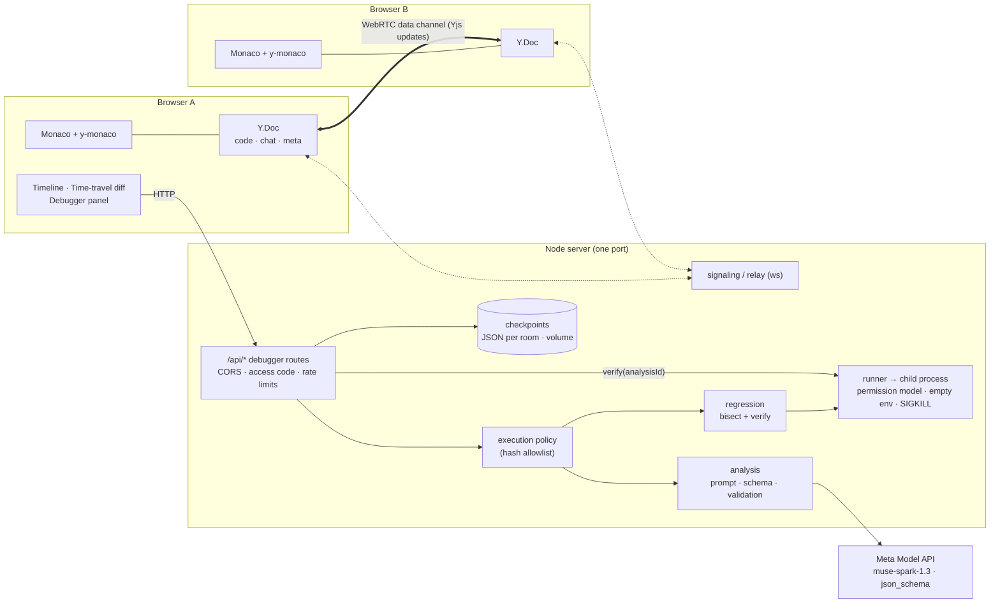
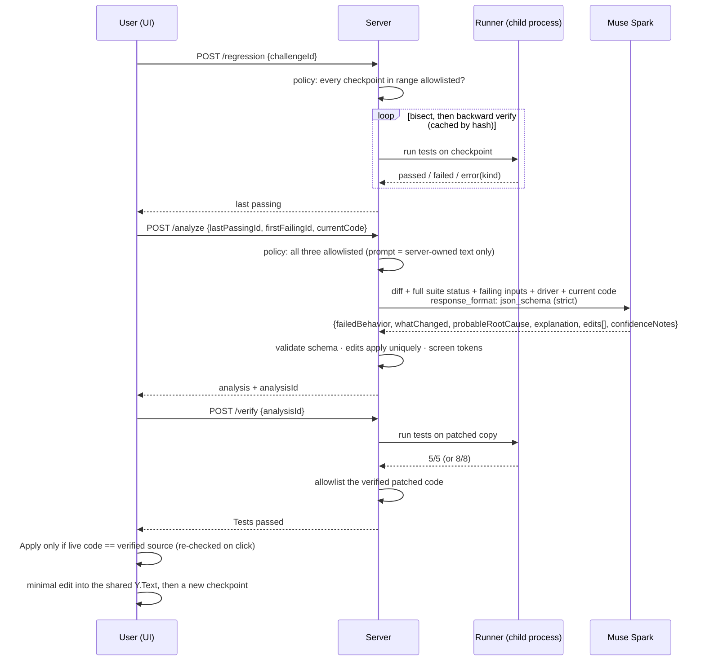
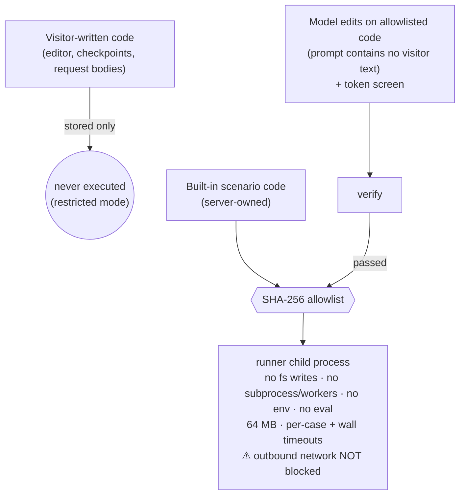

# Architecture

## System

- **Collaboration** is unchanged from the original PeerCode: a Yjs CRDT over WebRTC, with a server relay that forwards updates and never stores them.
- **Checkpoints** are explicit full snapshots, stored on the server with a server-assigned sequence number and a SHA-256 hash. When anyone checkpoints, a counter in the shared `Y.Map` changes and every peer refetches.
- **Time travel** opens read-only Monaco diff models. They're never bound to the live `Y.Text`.

## The debugging pipeline

## Trust boundary (what may execute)

`EXECUTION_MODE=local` removes the allowlist, for a developer's own machine only. The server refuses to start with it on Railway or Render. If the startup self-check finds the child-process restrictions aren't enforced, execution is disabled entirely.

## Key decisions
| Decision | Why | Trade-off |
|---|---|---|
| Snapshots, not Yjs updates, as checkpoints | Meaningful, exact, diffable units; independent of CRDT internals | Storage (capped: 200 × 50 KB per room, 2,000 rooms) |
| Bisect, then backward linear verification | O(log n) when the failing tail is short; exact for "the failure that persists to the head" | Long failing tails cost about as much as a linear scan; flips before the boundary can go unseen (Full scan exists for that) |
| Strict `json_schema` + server validation | Decoding is constrained to the schema; validation also checks what a schema can't (`find` occurs exactly once) | One retry, and a `json_object` fallback if a schema is ever rejected |
| Find/replace edits instead of unified diffs | Unambiguous: an edit either applies exactly or is rejected | Can't express moves; fine for minimal fixes |
| Verification bound to exact source; apply re-checked on click | A test result is evidence only about the code it ran on | A collaborator's edit blocks apply until it's undone (public) or re-verified (local) |
| Hash allowlist instead of a sandbox | Railway offers no verifiable container/network isolation; a JS-level sandbox can't be trusted | Visitors can't run their own code on the public demo |
| Deterministic async tests (deferred promises, microtask flush) | Race conditions tested without timers or sleeps | Scenarios are scripted by the challenge author |
